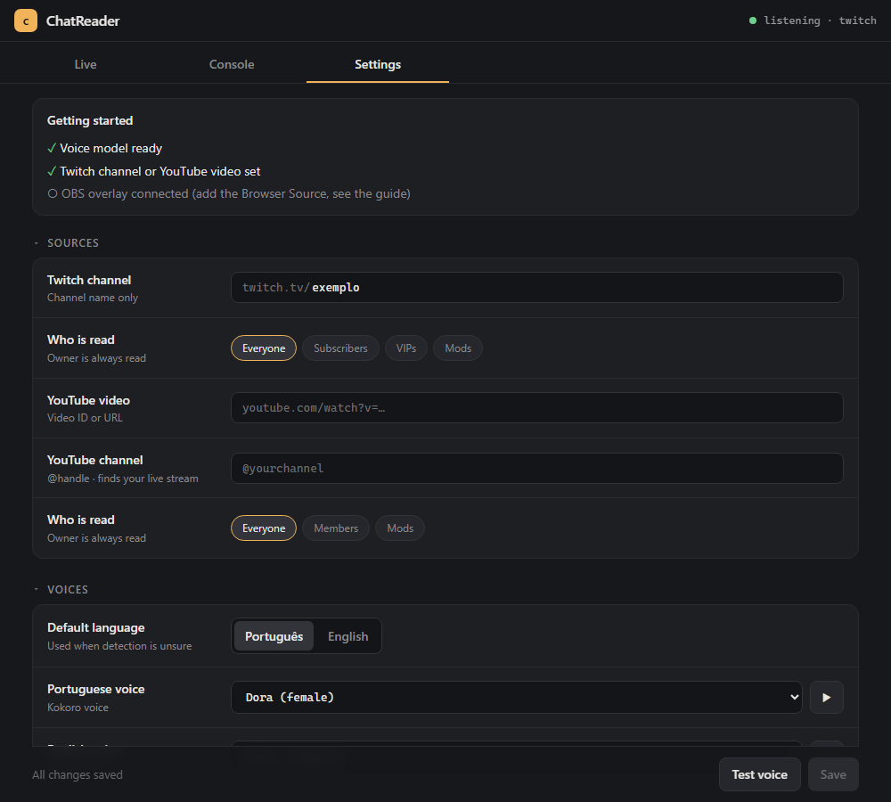

# ChatReader

Reads your **Twitch** and **YouTube** live chat out loud, in Portuguese (BR) and English. A small Windows tray app: the voice is generated on your own PC with [Kokoro-82M](https://huggingface.co/hexgrad/Kokoro-82M) (no cloud, no account) and reaches your stream through an OBS Browser Source.

## Features

- Twitch (anonymous, no login) and YouTube live chat
- Picks Portuguese or English per message; optional different voice per viewer
- Filters bots, `!commands`, links, repeats and spam; read only subs, VIPs or mods if you want
- Control from the tray icon or an OBS dock: pause, skip, edit the queue
- Local only: the server listens on `127.0.0.1`

## Get started

1. Download `ChatReader-<version>-win64.zip` from [Releases](https://github.com/Masgod/TTS-test/releases), unzip it and run `ChatReader.exe`. The voice model (about 120 MB) downloads on first run.
2. In the settings page that opens, type your Twitch channel (or YouTube video link) and press **Save**.
3. In OBS add a **Browser** source with URL `http://127.0.0.1:8765/overlay` and tick **Control audio via OBS**.

The build is not signed, so Windows may warn; the [guide](docs/GUIDE.md#1-install) explains how to verify the zip. Prefer Python? Run from source with `uv sync` then `uv run python -m chatreader`.

## Documentation

| | |
|---|---|
| [User guide](docs/GUIDE.md) | Install, OBS setup, settings, troubleshooting |
| [Configuration and API](docs/CONFIGURATION.md) | Every `config.toml` key, tray menu, OBS dock, local API |
| [Development](docs/DEVELOPMENT.md) | Run from source, build the app, how it works |
| [Status](docs/STATUS.md) | What has been tested, what has not, known limits |
| [Licences](docs/LICENSES.md) | Voice model, GPL components, what to check before monetizing |

## Status

Early version (0.1.0). The automated tests pass and live Twitch chat has been tested. YouTube live chat reads the public page, so it can break when YouTube changes; it has not been tested live yet. Details and known limits: [Status](docs/STATUS.md).

## License

MIT, see [LICENSE](LICENSE). Third-party components are listed in [THIRD_PARTY_NOTICES.txt](THIRD_PARTY_NOTICES.txt); the built zip includes GPL-3.0 parts, see [Licences](docs/LICENSES.md).
